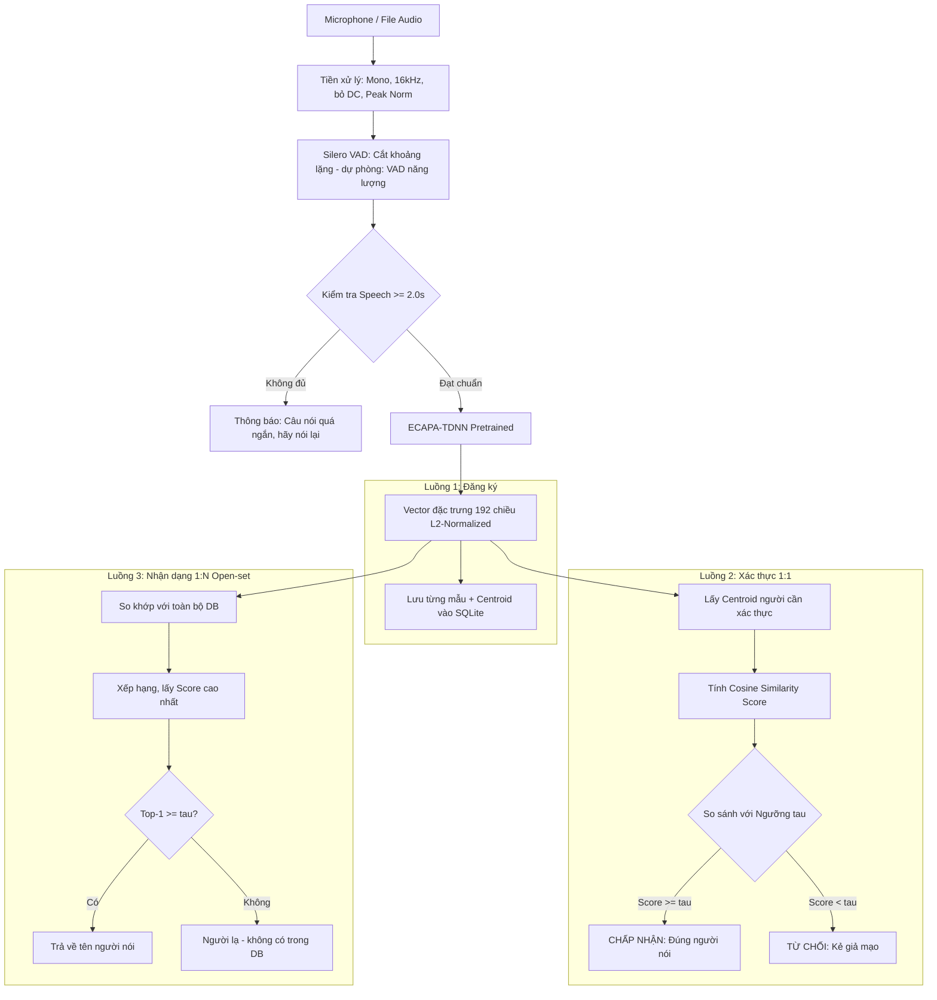
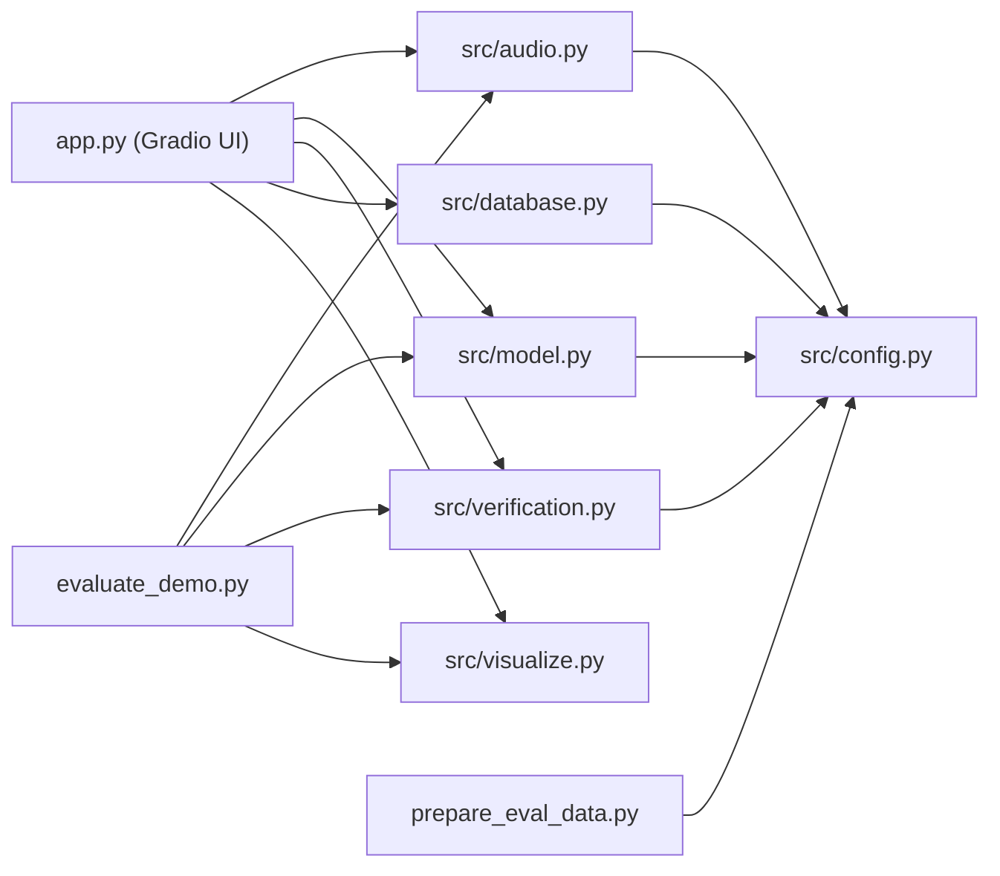

# KIẾN TRÚC HỆ THỐNG XÁC THỰC GIỌNG NÓI
**Đồ án môn học: Xử lý tiếng nói (Speech Processing)**  
*Mục tiêu: Đạt điểm tối đa với thiết kế chuẩn học thuật, tinh gọn, không cần huấn luyện mô hình, chạy mượt trên máy cá nhân.*

---

## 1. TỔNG QUAN HỆ THỐNG (SYSTEM OVERVIEW)

* **Bài toán:** Xác thực người nói độc lập nội dung (**Text-Independent Speaker Verification**) theo cơ chế tập mở (**Open-set**).
* **Đặc điểm cốt lõi:**
  * **Zero-shot / Pretrained-only:** Tận dụng mô hình SOTA có sẵn (**ECAPA-TDNN** từ SpeechBrain), **hoàn toàn không cần train lại mô hình**.
  * **Đăng ký tức thì (Zero retraining Enrollment):** Thêm người dùng mới bất cứ lúc nào, chỉ mất 1 giây trích xuất vector.
  * **Chạy Offline trên CPU:** Tốc độ xác thực cực nhanh ($< 0.5$ giây), không cần card màn hình rời (GPU).

---

## 2. SƠ ĐỒ LUỒNG XỬ LÝ (PIPELINE WORKFLOW)

### Sơ đồ phụ thuộc module

---

## 3. CHI TIẾT CÁC THÀNH PHẦN KỸ THUẬT (TECHNICAL MODULES)

### 3.1. Module Xử lý âm thanh & VAD (`src/audio.py`)
*Rất quan trọng trong môn Xử lý tiếng nói – ghi điểm cao khi thuyết trình.*
1. **Chuẩn hóa tín hiệu** (`standardize`):
   * Đưa mọi định dạng PCM (int16/int32/uint8/float) về `float32` trong $[-1, 1]$.
   * Trộn kênh về Mono (trung bình cộng).
   * Resample về $16\,\text{kHz}$ bằng bộ lọc đa pha `resample_poly` (có lọc thông thấp chống aliasing).
   * Loại bỏ thành phần DC: $x \leftarrow x - \bar{x}$.
   * Peak Normalization: $x_{\text{norm}} = 0.95 \cdot x / \max|x|$.
2. **Lọc khoảng lặng** (`apply_vad`):
   * **Silero VAD** (mạng nơ-ron TorchScript, siêu nhẹ): ngưỡng xác suất $0.5$, đoạn speech tối thiểu $250\,\text{ms}$, khoảng lặng tối thiểu $150\,\text{ms}$, đệm $60\,\text{ms}$.
   * **Dự phòng – VAD năng lượng ngắn hạn** (`energy_vad`): khung $25\,\text{ms}$ / bước $10\,\text{ms}$, cửa sổ Hamming, ngưỡng thích nghi $\max(\text{noise floor} + 12\,\text{dB},\ \text{peak} - 45\,\text{dB})$, có *hangover* chống cắt vụn.
   * Ghép các đoạn speech, bỏ toàn bộ im lặng / tiếng thở.
3. **Kiểm tra độ dài tối thiểu:**
   * Sau VAD, giọng nói phải đạt $\ge 2.0$ giây, nếu không ném `SpeechTooShortError` → giao diện yêu cầu nói lại.

### 3.2. Module Trích xuất đặc trưng (`src/model.py`)
1. **Mô hình cốt lõi:** `speechbrain/spkrec-ecapa-voxceleb`
   * Kiến trúc: **ECAPA-TDNN** (Squeeze-and-Excitation + Multi-layer feature aggregation + Attentive Statistics Pooling).
   * Được huấn luyện trước trên hơn 7.000 người nói (VoxCeleb 1+2).
   * Nạp một lần duy nhất (singleton `SpeakerEncoder.get()`, thread-safe), cache tại `pretrained_models/`.
2. **Đầu ra:** Vector đặc trưng âm học $E \in \mathbb{R}^{192}$ được chuẩn hóa $L_2$ ($\Vert E \Vert_2 = 1$).

### 3.3. Module So khớp & Ra quyết định (`src/verification.py`)
1. **Đo độ tương đồng (Cosine Similarity):**
   $$\text{Score} = E_{\text{enroll}} \cdot E_{\text{test}} = \cos(E_{\text{enroll}}, E_{\text{test}})$$
   * Giá trị dao động trong khoảng $[-1.0, 1.0]$.
2. **Ngưỡng quyết định ($\tau$):**
   * Đặt mặc định $\tau \approx 0.65$ (có thể tinh chỉnh qua thanh trượt Slider trên giao diện).
   * $\text{Score} \ge \tau \rightarrow$ **Đúng người (Genuine)**.
   * $\text{Score} < \tau \rightarrow$ **Giả mạo (Imposter)**.
3. **Nhận dạng 1:N tập mở** (`identify`): xếp hạng toàn bộ CSDL bằng một phép nhân ma trận; nếu điểm Top-1 $< \tau$ → **người lạ**.
4. **Độ đo đánh giá:** `compute_eer` (Equal Error Rate), `far_frr` (FAR / FRR tại ngưỡng $\tau$).

### 3.4. Lưu trữ cơ sở dữ liệu (`src/database.py`)
* **SQLite đơn giản (`data/database.db`):** 
  * Bảng `users`: `id`, `name` (UNIQUE), `embedding` (BLOB 192 × float32 – **centroid** đã chuẩn hóa $L_2$), `n_samples`, `created_at`, `updated_at`.
  * Bảng `samples`: lưu từng embedding riêng lẻ (`user_id`, `embedding`, `duration`) → có thể bổ sung mẫu và tính lại centroid bất cứ lúc nào.
  * Centroid: $\bar{E} = \dfrac{\sum_k E_k}{\Vert \sum_k E_k \Vert_2}$ – trung bình nhiều mẫu giúp giảm nhiễu phiên ghi âm.
  * Nhẹ nhàng, không cần cài đặt phần mềm database cồng kềnh, dễ copy sang máy khác để chấm bài.

### 3.5. Giao diện Web Demo (`app.py` bằng Gradio + `assets/style.css`)
* Thiết kế giao diện trực quan, bắt mắt (dark / glassmorphism) bằng **Gradio**:
  * **Tab 1 - Đăng ký (Enrollment):** Nhập tên $\rightarrow$ thu âm trực tiếp từ Microphone (1–3 mẫu) $\rightarrow$ Đăng ký thành công (tuỳ chọn ghi đè / bổ sung mẫu).
  * **Tab 2 - Xác thực (1:1 Verification):** Chọn tên trong danh sách $\rightarrow$ bấm mic nói 1 câu $\rightarrow$ Hiển thị thanh đo điểm số Cosine và kết luận Accept / Reject.
  * **Tab 3 - Nhận dạng (1:N Identification):** Chỉ cần bấm mic nói 1 câu $\rightarrow$ Hệ thống tự đoán xem đây là giọng của ai (hoặc báo *người lạ*) kèm biểu đồ xếp hạng.
  * **Tab 4 - Phân tích tín hiệu:** Sóng âm trước/sau VAD, spectrogram, SNR ước lượng (`src/visualize.py`).
  * **Tab 5 - Quản lý CSDL:** Xem danh sách / xoá người dùng.
  * **Tab 6 - Giới thiệu:** Tóm tắt pipeline và công nghệ.

### 3.6. Đánh giá & Dữ liệu thử nghiệm
* `prepare_eval_data.py`: tải *streaming* tập con **LibriSpeech dev-clean** (cân bằng nam/nữ, xoay vòng chương sách) vào `data/eval_librispeech/`.
* `evaluate_demo.py`: tính điểm mọi cặp Genuine / Imposter, EER, AUC, FAR/FRR tại $\tau$, Top-1 nhận dạng (leave-one-out); xuất biểu đồ vào `reports/`.
* Dữ liệu tự thu của nhóm đặt tại `data/eval/<tên>/*.wav`.

### 3.7. Đối chiếu thiết kế ↔ mã nguồn

| Thành phần | File | Hàm / Lớp chính |
| :--- | :--- | :--- |
| Cấu hình (16 kHz, $\tau$, VAD, đường dẫn) | `src/config.py` | hằng số `SAMPLE_RATE`, `DEFAULT_THRESHOLD`, ... |
| Tiền xử lý + VAD | `src/audio.py` | `standardize`, `apply_vad`, `process`, `process_file` |
| Trích xuất embedding | `src/model.py` | `SpeakerEncoder.get().embed()` |
| So khớp & độ đo | `src/verification.py` | `verify`, `identify`, `compute_eer`, `far_frr` |
| CSDL | `src/database.py` | `SpeakerDB.enroll / get / all_embeddings` |
| Biểu đồ | `src/visualize.py` | waveform, spectrogram, phân phối điểm |
| Giao diện | `app.py` | `build_ui`, `enroll_fn`, `verify_fn`, `identify_fn` |
| Đánh giá | `evaluate_demo.py`, `prepare_eval_data.py` | `main` |

---

## 4. BỘ CÔNG CỤ CÔNG NGHỆ TINH GỌN (LIGHTWEIGHT TECH STACK)

| Hạng mục | Công nghệ | Lý do lựa chọn cho đồ án |
| :--- | :--- | :--- |
| **Ngôn ngữ** | `Python 3.9+` | Chuẩn cho xử lý tiếng nói và AI |
| **Mô hình Pretrained** | `SpeechBrain (ECAPA-TDNN)` | Miễn phí, SOTA, tải về dùng ngay |
| **VAD** | `Silero VAD` | Siêu nhẹ, chạy mượt trên CPU |
| **Xử lý tín hiệu** | `torchaudio`, `soundfile` | Xử lý file WAV nhanh chóng |
| **Lưu trữ** | `SQLite3` (tích hợp sẵn trong Python) | Không cần cài đặt thêm server DB |
| **Giao diện Demo** | `Gradio` | Thu âm trực tiếp qua mic trình duyệt, code ngắn gọn |
| **Vẽ biểu đồ** | `matplotlib`, `seaborn` | Vẽ biểu đồ sóng âm (Waveform) & Phổ (Spectrogram) cho báo cáo |
