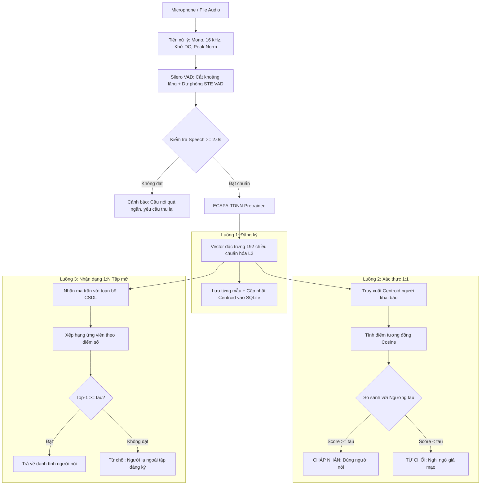
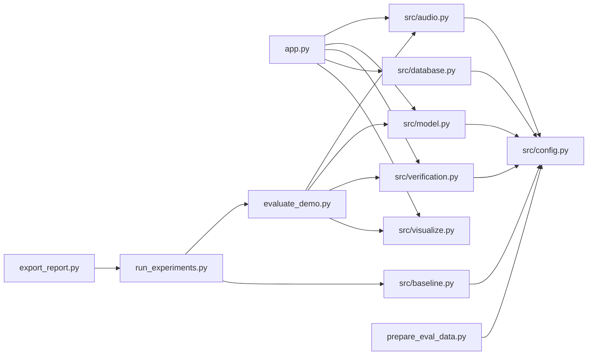

# KIẾN TRÚC HỆ THỐNG XÁC THỰC GIỌNG NÓI
**Đồ án môn học: Xử lý tiếng nói**  

---

## 1. TỔNG QUAN HỆ THỐNG

* **Bài toán:** Xác thực người nói độc lập nội dung và Nhận dạng người nói theo cơ chế tập mở.
* **Đặc điểm kỹ thuật cốt lõi:**
  * **Khai thác mô hình tiền huấn luyện:** Ứng dụng mạng học sâu **ECAPA-TDNN** từ thư viện SpeechBrain huấn luyện trên kho ngữ liệu VoxCeleb 1+2, không yêu cầu huấn luyện lại mô hình.
  * **Đăng ký đa mẫu tức thì:** Hợp nhất các mẫu giọng nói của người dùng thành vector trọng tâm Centroid chuẩn hóa $L_2$ lưu trữ trong SQLite, thời gian trích xuất dưới $0.6$ giây trên mỗi mẫu.
  * **Vận hành ngoại tuyến trên CPU:** Tích hợp bộ lọc khoảng lặng hai tầng gồm mạng nơ-ron **Silero VAD** và thuật toán năng lượng ngắn hạn dự phòng, đảm bảo tốc độ xử lý thời gian thực mà không cần GPU rời.

---

## 2. SƠ ĐỒ LUỒNG XỬ LÝ TỔNG THỂ

### Sơ đồ phụ thuộc các mô-đun phần mềm

---

## 3. CHI TIẾT CÁC THÀNH PHẦN KỸ THUẬT

### 3.1. Mô-đun Xử lý âm thanh và Lọc khoảng lặng (`src/audio.py`)
1. **Chuẩn hóa tín hiệu số (`standardize`):**
   * Ánh xạ mọi định dạng PCM nguyên hoặc thực về `float32` trong miền $[-1, 1]$.
   * Trộn các kênh âm thanh về đơn kênh Mono bằng trung bình cộng.
   * Lấy mẫu lại về tần số chuẩn $16\,\text{kHz}$ thông qua bộ lọc đa pha `resample_poly` tích hợp lọc thông thấp chống chồng phổ.
   * Khử thành phần một chiều DC: $x \leftarrow x - \bar{x}$.
   * Chuẩn hóa biên độ đỉnh: $x_{\text{norm}} = 0.95 \cdot x / \max|x|$.
2. **Phát hiện hoạt động tiếng nói (`apply_vad`):**
   * **Nhánh chính — Silero VAD:** Mạng nơ-ron tích chập kết hợp hồi quy biên dịch TorchScript, nạp trực tiếp từ bộ nhớ đệm `BytesIO`, ngưỡng xác suất $0.5$, đoạn tiếng nói tối thiểu $250\,\text{ms}$, khoảng lặng tách đoạn $150\,\text{ms}$, vùng đệm hai biên $60\,\text{ms}$.
   * **Nhánh dự phòng — VAD năng lượng ngắn hạn (`energy_vad`):** Chia khung $25\,\text{ms}$, bước nhảy $10\,\text{ms}$, cửa sổ Hamming, ngưỡng thích nghi $\max(\text{noise floor} + 12\,\text{dB},\ \text{peak} - 45\,\text{dB})$ kèm cơ chế duy trì trạng thái chống cắt cụt âm tiết.
3. **Kiểm định thời lượng tối thiểu:**
   * Tổng thời lượng tiếng nói hữu ích sau VAD phải đạt $\ge 2.0$ giây; trường hợp ngắn hơn sẽ kích hoạt ngoại lệ `SpeechTooShortError`.

### 3.2. Mô-đun Trích xuất đặc trưng học sâu (`src/model.py`)
1. **Mô hình trung tâm:** `speechbrain/spkrec-ecapa-voxceleb`
   * Kiến trúc **ECAPA-TDNN** kết hợp các khối tích chập giãn nở đa tỉ lệ `SE-Res2Block`, tổng hợp đặc trưng đa tầng `MFA` và gộp thống kê có trọng số chú ý theo kênh `Attentive Statistics Pooling`.
   * Khởi tạo theo mẫu thiết kế Singleton an toàn đa luồng, lưu trữ cục bộ tại `pretrained_models/`.
2. **Vector đầu ra:** Biểu diễn âm học $E \in \mathbb{R}^{192}$ chuẩn hóa $L_2$ thỏa mãn $\Vert E \Vert_2 = 1$.

### 3.3. Mô-đun Các giải pháp tham chiếu Baseline (`src/baseline.py`)
1. **Baseline 1 — MFCC + Statistical Pooling + Cosine (`extract_mfcc_supervector`):**
   * Trích xuất $20$ hệ số MFCC tĩnh cùng $20$ đạo hàm bậc nhất $\Delta$ và $20$ đạo hàm bậc hai $\Delta\Delta$ trên mỗi khung $25\,\text{ms}$, sau đó gộp trung bình và độ lệch chuẩn theo thời gian thành siêu vector $120$ chiều chuẩn hóa $L_2$.
2. **Baseline 2 — MFCC + GMM-UBM (`GMMUBMVerifier`):**
   * Huấn luyện mô hình nền phổ quát UBM gồm $16$ thành phần Gaussian hiệp phương sai đường chéo trên đặc trưng MFCC $60$ chiều chuẩn hóa CMVN, thực hiện thích nghi hậu nghiệm cực đại MAP với hệ số $r = 10$ và chấm điểm bằng tỉ số hợp lý logarit LLR.

### 3.4. Mô-đun So khớp và Ra quyết định (`src/verification.py`)
1. **Độ tương đồng Cosine:** $\text{Score} = E_{\text{enroll}} \cdot E_{\text{test}} = \cos(E_{\text{enroll}}, E_{\text{test}}) \in [-1.0, 1.0]$.
2. **Quyết định nhị phân:** So sánh với ngưỡng $\tau$: nếu $\text{Score} \ge \tau$ kết luận **Chấp nhận**, ngược lại **Từ chối**.
3. **Nhận dạng $1:N$ tập mở (`identify`):** Nhân ma trận giữa toàn bộ cơ sở dữ liệu với vector kiểm thử; chỉ định danh khi ứng viên hạng nhất đạt điểm $\ge \tau$.
4. **Độ đo đánh giá:** Tính toán tỉ lệ lỗi ngang bằng `compute_eer` và cặp chỉ số `far_frr`.

### 3.5. Cơ sở dữ liệu SQLite (`src/database.py`) và Giao diện Web (`app.py`)
* **Cơ sở dữ liệu `data/database.db`:** Bảng `users` lưu thông tin định danh và vector trọng tâm $\bar{E} = \frac{\sum_k E_k}{\Vert \sum_k E_k \Vert_2}$; bảng `samples` lưu từng vector mẫu riêng lẻ.
* **Giao diện Gradio (`app.py`):** Cung cấp 6 phân trang gồm Đăng ký, Xác thực $1:1$, Nhận dạng $1:N$, Phân tích tín hiệu, Quản lý cơ sở dữ liệu và Giới thiệu.

---

## 4. TỔNG HỢP KẾT QUẢ THỰC NGHIỆM ĐỊNH LƯỢNG

### 4.1. Phân tích ảnh hưởng cải tiến VAD và Đa mẫu Centroid (Tiêu chí 4)

* **Ảnh hưởng của VAD trên dữ liệu thu âm chuẩn và phiên thu có khoảng chờ $1.5\,\text{s}$ hai đầu:**
  * Việc tích hợp **Silero VAD** giúp cắt bỏ $21.4\%$ thời lượng khoảng lặng trên bản thu chuẩn và loại bỏ $54.4\%$ thời lượng dư thừa trên phiên thu thực tế, rút ngắn thời gian suy luận CPU từ $1033\,\text{ms}$ xuống $332\,\text{ms}$ mỗi mẫu.
* **Ảnh hưởng của số mẫu đăng ký hợp nhất Centroid ($K = 1 \rightarrow 4$):**
  * Trên tập tiếng Anh LibriSpeech: tăng $K$ từ $1$ lên $4$ mẫu giúp giảm EER từ $4.11\%$ xuống $1.11\%$ và nâng độ chính xác nhận dạng Top-1 từ $96.0\%$ lên $100.0\%$.
  * Trên tập tiếng Việt VIVOS: tăng $K$ từ $1$ lên $4$ mẫu giúp giảm EER từ $2.11\%$ xuống $1.00\%$ và nâng điểm tương đồng Genuine trung bình từ $0.721$ lên $0.813$.

### 4.2. Đối sánh trực tiếp với các mô hình Baseline (Tiêu chí 9)

| Mô hình / Giải pháp | Tập dữ liệu | Biểu diễn | EER (%) ↓ | AUC ↑ | Top-1 LOO (%) ↑ | Thời gian CPU |
| :--- | :--- | :--- | :---: | :---: | :---: | :---: |
| **MFCC + StatPool + Cosine** | LibriSpeech | Vector 120-D | 18.07% | 0.8886 | 86.0% | 7.0 ms |
| **MFCC + GMM-UBM (MAP)** | LibriSpeech | 16 Gaussian × 60-D | 8.18% | 0.9774 | 94.0% | 141.6 ms |
| **ECAPA-TDNN + Cosine (Đề xuất)** | LibriSpeech | Embedding 192-D | **3.13%** | **0.9723** | **100.0%** | 571.0 ms |
| **MFCC + StatPool + Cosine** | VIVOS Tiếng Việt | Vector 120-D | 5.08% | 0.9871 | 98.0% | 5.1 ms |
| **MFCC + GMM-UBM (MAP)** | VIVOS Tiếng Việt | 16 Gaussian × 60-D | 3.78% | 0.9917 | 100.0% | 35.4 ms |
| **ECAPA-TDNN + Cosine (Đề xuất)** | VIVOS Tiếng Việt | Embedding 192-D | **0.90%** | **0.9988** | **100.0%** | 548.8 ms |

### 4.3. Đánh giá mở rộng dưới môi trường nhiễu đa mức trên Tiếng Việt (Tiêu chí 10)

| Mức tỉ số SNR | Nhiễu trắng White (EER / Top-1) | Nhiễu môi trường Pink (EER / Top-1) | Nhiễu đám đông Babble (EER / Top-1) | Baseline GMM-UBM (EER White) |
| :--- | :---: | :---: | :---: | :---: |
| **Sạch ($\infty$ dB)** | 0.90% / 100% | 0.90% / 100% | 0.90% / 100% | 3.78% |
| **SNR = 20 dB** | 4.23% / 100% | 4.61% / 100% | 3.66% / 100% | 11.12% |
| **SNR = 15 dB** | 4.07% / 100% | 4.34% / 100% | 4.07% / 100% | 15.84% |
| **SNR = 10 dB** | 5.62% / 100% | 4.56% / 100% | 4.45% / 100% | 21.06% |
| **SNR = 5 dB** | 7.51% / 98% | 5.11% / 100% | 8.76% / 100% | 24.52% |
| **SNR = 0 dB** | 10.47% / 94% | 8.47% / 96% | 20.52% / 76% | 28.49% |

---

## 5. TÀI LIỆU THAM KHẢO CHUẨN IEEE

[1] B. Desplanques, J. Thienpondt, and K. Demuynck, "ECAPA-TDNN: Emphasized Channel Attention, Propagation and Aggregation in TDNN Based Speaker Verification," in *Proc. Interspeech*, Shanghai, China, 2020, pp. 3830–3834.  
[2] D. A. Reynolds, T. F. Quatieri, and R. B. Dunn, "Speaker Verification Using Adapted Gaussian Mixture Models," *Digital Signal Processing*, vol. 10, no. 1–3, pp. 19–41, Jan. 2000.  
[3] M. Ravanelli *et al.*, "SpeechBrain: A General-Purpose Speech Toolkit," *arXiv preprint arXiv:2106.04624*, 2021.  
[4] L. R. Rabiner and R. W. Schafer, *Theory and Applications of Digital Speech Processing*. Upper Saddle River, NJ, USA: Pearson, 2010.  
[5] Silero Team, "Silero VAD: Pre-trained Enterprise-Grade Voice Activity Detector," GitHub repository, 2021. [Online]. Available: https://github.com/snakers4/silero-vad.  
[6] D. Snyder, D. Garcia-Romero, G. Sell, D. Povey, and S. Khudanpur, "X-Vectors: Robust DNN Embeddings for Speaker Recognition," in *Proc. IEEE ICASSP*, Calgary, AB, Canada, 2018, pp. 5329–5333.  
[7] A. Nagrani, J. S. Chung, W. Xie, and A. Zisserman, "VoxCeleb: Large-Scale Speaker Verification in the Wild," *Computer Speech & Language*, vol. 60, p. 101027, Mar. 2020.  
[8] V. Panayotov, G. Chen, D. Povey, and S. Khudanpur, "LibriSpeech: An ASR Corpus Based on Public Domain Audio Books," in *Proc. IEEE ICASSP*, South Brisbane, QLD, Australia, 2015, pp. 5206–5210.  
[9] H. T. Luong and H. Q. Vu, "A Non-Expert Kaldi Recipe for Vietnamese Speech Recognition System," in *Proc. WLSI/OIAF4HLT*, Osaka, Japan, 2016, pp. 51–55.  
[10] J. Deng, J. Guo, N. Xue, and S. Zafeiriou, "ArcFace: Additive Angular Margin Loss for Deep Face Recognition," in *Proc. IEEE/CVF CVPR*, Long Beach, CA, USA, 2019, pp. 4690–4699.
